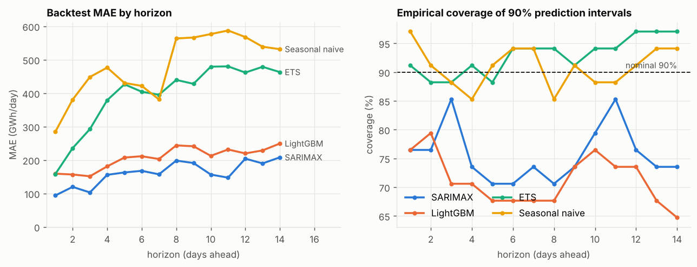
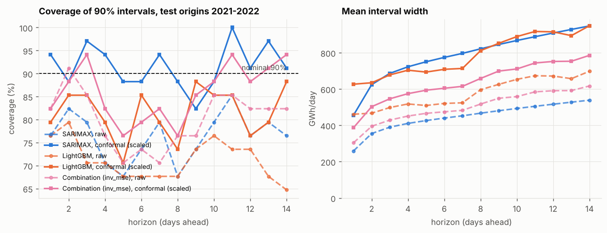
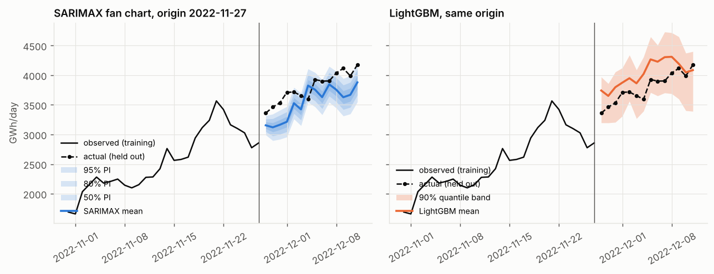

# Energy demand forecasting: German daily natural-gas consumption

Forecasting daily German natural-gas demand 1-14 days ahead with statistical baselines, a
regression model with ARIMA errors (SARIMAX), LightGBM and their combination, evaluated with a
rolling-origin backtest, Diebold-Mariano tests, conformally calibrated prediction intervals
(coverage, pinball loss, CRPS), a pre-crisis vs crisis regime breakdown and a stylised
imbalance-cost translation.

## Business problem

A gas shipper or trader has to nominate tomorrow's volumes and hedge the coming weeks before
demand is known. Any gap between forecast and realised consumption ends up as a balancing
position. In the German market area (Trading Hub Europe, THE) that position is cashed out at
balancing prices that are less favourable than the VHP day-ahead index. Forecast accuracy over
1-14 days therefore has a direct cost. This project asks three questions:

1. How much better than naive benchmarks can daily national gas demand be forecast, 1-14 days ahead?
2. Is a gradient-boosting model better than a well-specified time-series regression on this problem?
3. Can the prediction intervals be trusted for risk decisions, and does accuracy survive the 2022 crisis?
4. What does the error mean in EUR under stated assumptions?

## Data

| Series | Period used | Source | Licence / terms |
|---|---|---|---|
| Daily gas consumption, all customer groups (SLP + RLM, H- and L-gas) | 2016-10-01 to 2022-12-31 | Market area managers NetConnect Germany and GASPOOL (until 2021-09-30), then Trading Hub Europe GmbH ("Aggregated consumption data") | Public transparency publications of THE; no open licence is stated, so the raw files are **not** redistributed here |
| Daily 2 m air temperature, Germany country average (NUTS0) | same | Copernicus Climate Change Service (C3S), *Climate and energy indicators for Europe from 1979 to present derived from reanalysis*, ERA5, doi:10.24381/cds.4bd77450 | Copernicus licence, attribution required: "Generated using Copernicus Climate Change Service information" |
| Daily balancing (imbalance) prices and VHP index | 2021-10-01 to 2022-11-28 | Trading Hub Europe GmbH, imbalance prices | as above |

The files are downloaded by `data/download_data.py` from a public GitHub repository that archived
them for a research project ([f-linus/natural_gas_consumption_modelling](https://github.com/f-linus/natural_gas_consumption_modelling),
pinned to commit `be4c9ed`). Only derived results are committed.

Construction (`src/data.py`): before October 2021 Germany had two market areas, so national
demand is NCG + GASPOOL (unit-harmonised to GWh/day); from 2021-10-01 the merged THE area is used.
The sample is 2,283 days without gaps, mean demand 2,663 GWh/day (about 970 TWh/year).
The sample ends on 2022-12-31 because the temperature extract ends there.

Two features of the data shape every modelling choice:

* Demand is driven by heating. Below about 15 deg C consumption rises almost linearly as
  temperature falls, a little faster in frost ([scatter](reports/figures/fig2_demand_vs_temperature.png)).
  Weekends are about 270 GWh/day lower and public holidays about 200 GWh/day lower (SARIMAX
  coefficients), mainly because industry consumes less.
* There is a **structural break** in autumn 2022: after the price shock, demand at a given
  temperature fell visibly (orange points in the scatter, MSTL trend below). Half of the test
  period lies in 2022, so the backtest is not a calm-market evaluation.


## Approach

**Models** (`src/models.py`, one interface `fold -> mean, lo, hi`):

| Model | What it uses | Why it is here |
|---|---|---|
| Seasonal naive (m = 7) | same weekday last week | minimal benchmark and MASE scale |
| ETS(A,Ad,A), weekly seasonality | consumption only, last 2 years | how far can you go without weather? |
| Regression with ARIMA(1,1,2) errors ("SARIMAX") | weighted heating degree days (linear + frost hinge, weekend slope), holiday and Christmas flags, weekday dummies | classical, interpretable model for temperature-driven load |
| LightGBM, direct multi-horizon | consumption lags, rolling means, temperature forecast, calendar | non-linear benchmark that is popular in practice |
| Combination of SARIMAX and LightGBM | equal weights, or inverse-MSE weights per horizon from past errors | does pooling two different models help? |

**Data split.** Origins every 21 days on one grid: 22 **validation origins** (2019-09-29 to
2020-12-13, all targets before 2021-01-03) and 34 **test origins** (2021-01-03 to 2022-11-27),
horizons 1-14, so 476 test forecasts per model. Every model is re-estimated at every origin
(expanding window). Validation origins are used for three things only: choosing the SARIMAX
specification, the initial calibration set of the conformal intervals and the first
combination weights. No choice was made on the test origins.

**SARIMAX specification** (`src/diagnostics.py`, `src/sarimax_selection.py`):

* Exogenous part: heating degree days `max(15 - T_w, 0)`, where `T_w` weights the temperature
  of the day and the three previous days by 1, 0.5, 0.25, 0.125 (German standard load profile
  convention: thermal inertia of buildings). Weekly seasonality via weekday dummies; a seasonal
  MA term on a seasonally differenced model went to -1 in exploration (deterministic seasonality).
* d = 1: on the regression residual ADF rejects a unit root but KPSS rejects stationarity
  (p <= 0.01) and the ACF decays slowly; after one difference both agree. A BIC grid over
  p, q in {0, 1, 2} on data up to the first test origin selects ARIMA(1,1,2).
* **Residual autocorrelation fix.** The baseline left autocorrelation (Ljung-Box p = 0.004 at
  lag 7, 0.040 at 14). Candidates, each with a reason: (a) a seasonal AR(1) at lag 7 (weekly
  persistence of shocks); (b) a non-linear temperature response: a second hinge `max(5 - T_w, 0)`
  (heating steepens in frost) plus `HDD x weekend` (offices and industry heat less on weekends);
  (c) both. Weekly Fourier terms are not a separate candidate: six weekday dummies already span
  the full weekly Fourier basis (K = 3). The rule, fixed in advance, was the lowest pooled
  validation MAE.

| Specification | validation MAE | BIC (pre-test fit) | Ljung-Box p, lag 7 / 14 / 28 |
|---|---:|---:|---|
| baseline | 181.2 | 18,119 | 0.004 / 0.040 / 0.051 |
| + weekly AR | 180.7 | 18,120 | 0.014 / 0.18 / 0.23 |
| + non-linear HDD | 176.8 | **18,011** | 0.016 / 0.21 / 0.56 |
| **+ non-linear HDD + weekly AR** (chosen) | **176.5** | 18,018 | 0.012 / 0.23 / 0.61 |

The frost hinge adds 32 GWh/day per degree below 5 deg C (s.e. 3.7) and the weekend slope is
6.6 GWh/day per HDD lower (s.e. 0.8). The seasonal AR coefficient is small and not significant
(0.03, p = 0.20): the improvement comes from the temperature terms, and BIC would have picked
the model without it. I kept the pre-declared rule. Lag-14 and lag-28 autocorrelation is gone;
lag 7 is still rejected at 5% (p = 0.012), a mild remaining weekly pattern.

**No look-ahead** (`src/features.py`, tests in `tests/`):

* *Future weather is not known.* A temperature-forecast archive is simulated as
  `realised + N(0, sd_h)` with `sd_h = 0.8 + 0.2 (h - 1)` deg C. This is an **assumption** (no
  archive of real weather forecasts was available), applied identically to all models.
* LightGBM rows are (origin t, horizon h); consumption features are dated <= t, target-day
  features are calendar and forecast temperature only; training rows need target date <= origin.
  Its target is `y(t+h) - mean(y(t-6..t))`; 5%/95% quantile models give the interval. The
  feature set was chosen on 2019-2020 validation folds (`src/validate_lgbm.py`); gain importance
  is in [fig6](reports/figures/fig6_feature_importance.png).
* Conformal calibration and inverse-MSE weights at origin t only use errors whose target date
  is <= t. Tests corrupt all later outcomes and check that nothing changes.

**Calibrated intervals** (`src/conformal.py`). Rolling split-conformal prediction. At each
test origin the calibration set is the model's own past out-of-sample errors (validation folds,
then earlier test folds), expanding as time passes. Primary variant, declared before seeing
test results: errors scaled by the model's predictive standard deviation and pooled over horizons
(308 scores at the first origin, 770 at the last). The scaled version keeps the model's horizon
profile and re-centres and re-scales it. Comparison variant: empirical quantiles of the raw
signed errors at the same horizon (22-55 scores). Both use the finite-sample conformal order
statistic for each tail. Evaluation: coverage, width, interval (Winkler) score, pinball loss of
the 5% and 95% quantiles, and CRPS approximated by twice the mean pinball loss over 19
quantiles (5%, 10%, ..., 95%). The day-ahead SARIMAX intervals are recalibrated the same way,
day by day, on all earlier day-ahead errors.

**Other evaluation.** MAE, RMSE, MAPE, MASE; Diebold-Mariano (HLN correction) per horizon and
on per-origin mean losses. **Day-ahead**: each fold's model is rolled forward daily until the next
origin (new data, no re-estimation): 727 h = 1 forecasts, DM with Newey-West variance.

## Results

### 1-14 day backtest (34 test origins, 2021-2022, 476 forecasts per model)

| Model | MAE (GWh/d) | RMSE | MAPE % | MASE | 90% PI coverage raw | coverage conformal |
|---|---:|---:|---:|---:|---:|---:|
| **SARIMAX (chosen spec)** | **154** | **203** | **6.57** | **0.38** | 76.3% | **91.6%** |
| Combination, inverse-MSE | 156 | 211 | 6.64 | 0.39 | 80.0% | 85.9% |
| Combination, equal weights | 158 | 212 | 6.74 | 0.40 | 78.6% | 85.7% |
| SARIMAX baseline spec | 161 | 214 | 6.84 | 0.40 | 75.8% | 90.8% |
| LightGBM | 207 | 284 | 8.62 | 0.52 | 71.2% | 81.5% |
| ETS (Holt-Winters) | 394 | 610 | 15.6 | 0.98 | 92.9% | - |
| Seasonal naive | 483 | 669 | 18.3 | 1.20 | 91.0% | - |

MAPE by horizon (%):

| h | SARIMAX | SARIMAX baseline | Comb. inv-MSE | LightGBM | ETS | Seasonal naive |
|---:|---:|---:|---:|---:|---:|---:|
| 1 | 3.4 | 4.2 | 3.5 | 6.1 | 5.9 | 11.0 |
| 3 | 4.1 | 3.9 | 3.8 | 5.7 | 11.5 | 15.9 |
| 7 | 6.9 | 7.4 | 7.5 | 9.4 | 17.2 | 16.5 |
| 14 | 8.9 | 8.6 | 8.7 | 10.8 | 18.7 | 20.8 |



**Diebold-Mariano** (n = 34 per row; negative = first model has the lower loss), squared / absolute loss:

| Comparison | h = 1 | h = 7 | h = 14 | 1-14 pooled |
|---|---|---|---|---|
| SARIMAX vs LightGBM | -2.56 (p 0.015) / -2.84 (0.008) | -1.62 (0.11) / -1.66 (0.11) | -1.32 (0.20) / -1.22 (0.23) | -1.85 (0.073) / -2.22 (0.033) |
| SARIMAX vs baseline spec | -2.41 (0.022) / -3.48 (0.001) | -1.93 (0.063) / -1.54 (0.13) | -0.27 (0.79) / 0.23 (0.82) | **-3.15 (0.003)** / -2.39 (0.023) |
| Comb. inv-MSE vs SARIMAX | 0.50 (0.62) / 0.84 (0.41) | 0.79 (0.43) / 1.16 (0.25) | 0.15 (0.88) / -0.39 (0.70) | 0.52 (0.60) / 0.22 (0.83) |
| Comb. equal vs SARIMAX | 1.59 (0.12) / 1.91 (0.064) | 0.81 (0.43) / 1.13 (0.27) | 0.03 (0.98) / -0.47 (0.64) | 0.60 (0.55) / 0.39 (0.70) |

* The residual-autocorrelation fix pays off out of sample: 1-14 day MAE 161 to 154 (-4.4%),
  significant on pooled losses; the gain is concentrated at h = 1 (MAPE 4.2% to 3.4%) and in the
  cold autumn of 2022 (below).
* **The combination does not beat the best single model.** Inverse-MSE weights give SARIMAX
  53-78% (`reports/tables/combination_weights_by_h.md`), and the pooled DM tests are far from
  significant. LightGBM's errors are not different enough, and it is biased in late 2022.

### Calibrated prediction intervals (test origins, nominal 90%)

| Model, method | coverage | below / above | mean width | interval score | pinball 5% / 95% | CRPS (19 q.) |
|---|---:|---|---:|---:|---|---:|
| SARIMAX, raw Gaussian | 76.3% | 12.4% / 11.3% | 447 | 1,045 | 25.6 / 26.7 | **118.4** |
| SARIMAX, conformal per horizon | 94.5% | 4.2% / 1.3% | 875 | 957 | 21.3 / 26.6 | 121.8 |
| **SARIMAX, conformal scaled** | **91.6%** | 6.1% / 2.3% | 787 | **903** | **21.4 / 23.7** | 119.3 |
| LightGBM, raw quantile models | 71.2% | 17.6% / 11.1% | 577 | 1,391 | 39.8 / 29.8 | 155.9 |
| LightGBM, conformal scaled | 81.5% | 15.5% / 2.9% | 785 | 1,216 | 33.1 / 27.8 | 162.4 |
| Comb. inv-MSE, conformal scaled | 85.9% | 12.2% / 1.9% | 638 | 902 | 22.8 / 22.3 | 123.0 |



* For SARIMAX the scaled conformal interval brings coverage from 76% to 92% and improves the
  proper interval score by 14% and both tail pinball losses. The price is a 76% wider band
  (787 vs 447 GWh/day), which is the honest width once weather-forecast and parameter
  uncertainty are counted. The per-horizon variant over-covers (94.5%) with only 22-55 scores
  per horizon.
* CRPS is essentially unchanged (118 to 119): CRPS is dominated by the centre of the
  distribution, which conformal recalibration does not improve; the gain is in the tails.
* Calibration cannot fix a bias that appears after the calibration window: LightGBM stays at
  82% because its errors became one-sided in late 2022 (see regimes).
* **Day-ahead** SARIMAX intervals: coverage 83.1% to 93.0%, width 259 to 372 GWh/day, interval
  score 469 to 460, CRPS 56.5 to 56.3.

Fan chart for the last origin (cold spell of December 2022), dotted = calibrated 90% interval:



### Regime robustness: pre-crisis 2021 vs crisis 2022 (by target date)

| Period | n (14-day / day-ahead) | SARIMAX | SARIMAX baseline | LightGBM | Comb. inv-MSE | SARIMAX conformal coverage |
|---|---|---|---|---|---|---:|
| 2021 pre-crisis | 243 / 362 | 6.00% / 2.83% | 6.20% / 3.00% | 8.05% / 5.19% | 6.21% / 2.89% | 90.5% |
| 2022 crisis | 233 / 365 | 7.17% / 3.29% | 7.50% / 3.51% | 9.22% / 7.57% | 7.08% / 3.58% | 92.7% |
| - 2022 Jan-Aug | 163 / 243 | 6.79% / 3.16% | 6.79% / 3.27% | 7.26% / 4.17% | 6.72% / 3.14% | 92.6% |
| - 2022 Sep-Dec (demand reduction) | 70 / 122 | 8.06% / 3.55% | 9.17% / 3.99% | 13.77% / 14.35% | 7.91% / 4.45% | 92.9% |

Cells are MAPE for the 1-14 day backtest / day-ahead (full tables with MAE, bias and coverage:
`reports/tables/metrics_by_regime.md`, `day_ahead_metrics_by_regime.md`).

* The 2022 crisis raised every model's percentage error, but in two different ways. In
  January-August (price shock, mild weather) all weather-driven models are close. From September,
  demand at a given temperature fell by several hundred GWh/day: LightGBM's day-ahead bias was
  -341 GWh/day (over-forecast) and its MAPE nearly tripled. Trees map temperature and lag levels to
  demand levels seen in training and cannot extrapolate a new regime. The integrated ARIMA error
  re-levels SARIMAX within days (day-ahead bias -2 GWh/day in the same months).
* The non-linear HDD terms helped most exactly when it got cold in late 2022 (MAPE 9.2% to 8.1%).
* The inverse-MSE combination is best on the 14-day backtest of Sep-Dec 2022 (7.9%: LightGBM's
  over-forecast offsets SARIMAX's under-forecast) but clearly worse day-ahead (4.45% vs 3.55%):
  expanding-window weights react too slowly to a regime change.
* Calibrated SARIMAX coverage stays at 90-93% in both regimes. The scaled scores absorb the
  change because the model itself stays centred.

### Day-ahead, every day of 2021-2022 (727 forecasts)

| Model | MAE (GWh/d) | MAPE % | bias (actual - forecast) | 90% PI coverage raw / conformal |
|---|---:|---:|---:|---|
| **SARIMAX** | **73.3** | **3.06** | -9.0 | 83.1% / 93.0% |
| SARIMAX baseline spec | 76.7 | 3.26 | -8.8 | 83.6% / - |
| Combination, inverse-MSE | 79.6 | 3.23 | -18.3 | - |
| Combination, equal | 101.4 | 4.01 | -30.2 | - |
| LightGBM | 164.4 | 6.39 | -51.3 | - |
| Seasonal naive | 399.0 | 14.45 | -16.4 | - |

DM (Newey-West, 7 lags), squared / absolute loss: SARIMAX vs baseline spec -2.83 (p 0.005) /
-3.77 (p < 0.001); SARIMAX vs LightGBM -5.26 / -6.97 (p < 0.001); inverse-MSE combination vs
SARIMAX +2.31 (p 0.021) / +2.66 (p 0.008), i.e. the combination is significantly *worse* day-ahead.

### Value of a better weather forecast (SARIMAX sensitivity)

The same fitted models with perfect future temperature lower the 1-14 day MAE from 154 to 116
GWh/day (MAPE 6.6% to 5.1%); at h = 1 from 79 to 76, at h = 14 from 210 to 123. Beyond a few
days, the quality of the temperature forecast matters more than the choice of model.

## What forecast error means for a gas shipper (illustrative)

Stylised assumptions (`src/business.py`): a shipper supplies **1% of German demand**, inherits
the model's day-ahead errors, buys the forecast volume at the VHP index, and settles any shortfall
(surplus) at THE's positive (negative) balancing price; the cost is measured against the index.
Over the 424 days with published prices (2021-10-01 to 2022-11-28) the spreads averaged 5.6 EUR/MWh
(pos - index) and 7.8 EUR/MWh (index - neg), with peaks of 47 and 70 EUR/MWh in 2022.

| Day-ahead model | mean abs. error (MWh/day) | mean imbalance cost (EUR/day) | total over 424 days (EUR) |
|---|---:|---:|---:|
| SARIMAX | 777 | 4,811 | 2.04 m |
| SARIMAX baseline spec | 805 | 4,948 | 2.10 m |
| Combination, inverse-MSE | 806 | 6,049 | 2.56 m |
| LightGBM | 1,475 | 14,374 | 6.09 m |
| Seasonal naive | 3,477 | 24,773 | 10.50 m |

The national aggregate is smoother than a real portfolio, SLP customers are allocated by
formula, and within-day tolerances are ignored. This ranks models in money terms; it is not a P&L.

## Key takeaways, limitations, next steps

* A transparent regression with ARIMA errors on weighted heating degree days beats LightGBM,
  significantly day-ahead and at short horizons. The reason is robustness to the autumn-2022
  level shift, not flexibility.
* Fixing the residual structure with physically motivated terms (frost hinge, weekend heating
  slope), chosen on validation folds, cut test MAE by 4% and day-ahead MAE by 4%, both significant.
* Raw model intervals under-cover (71-83%). Rolling conformal calibration on past
  out-of-sample errors gives 92-93% for SARIMAX with a better interval score. The width that
  goes with honest coverage is about 790 GWh/day at 1-14 days and 370 GWh/day day-ahead.
* Combining with a weaker, regime-fragile model did not help on average and hurt day-ahead.
* **Limitations.** Simulated temperature forecasts (assumed error), so real 7-14 day errors may
  differ. A single test period of 2 years, half of it a crisis; 34 origins give DM tests low power.
  Conformal validity assumes exchangeable errors, which a regime change violates (LightGBM shows
  the failure mode). Ljung-Box still rejects at lag 7 (p = 0.012). The seasonal AR term was kept
  by the pre-declared MAE rule although it is not significant.
* **Next steps.** A real weather-forecast archive; separate SLP and RLM models (industry drove
  the 2022 drop); gas price as a demand-destruction regressor; recency-weighted (or adaptive)
  conformal and combination weights; LightGBM on SARIMAX residuals; hourly models for within-day
  balancing.

## How to run

```bash
pip install -r requirements.txt
make all          # download data, run pipeline, run tests
make full         # additionally: LightGBM feature-set validation + re-execute the notebook
# or step by step
python data/download_data.py
python -m src.pipeline        # SARIMAX spec validation, backtest, calibration, reports
python -m pytest -q           # 35 tests on synthetic fixtures (no data needed)
python -m src.validate_lgbm   # optional, ~1.5 min: reports/tables/lgbm_feature_set_validation.md
```

`notebooks/walkthrough.ipynb` is executed (outputs saved), imports from `src/`, refits one fold
live and recomputes the conformal results. CI (`.github/workflows/tests.yml`) runs pytest; the same
steps were verified locally in a fresh venv from `requirements.txt` (35 passed). The workflow has
not run on GitHub yet because the repository has not been pushed.

Seed 42 everywhere. Runtime of `python -m src.pipeline` in the sandbox (2 CPUs): 9 min 52 s on an
idle machine, 18 min with other heavy jobs running; mostly SARIMAX re-estimation (4 specs x 23
validation fits, 2 x 34 test fits) and 56 x 3 LightGBM fits. Two runs reproduced every table exactly.

## Project structure

```
data/download_data.py      fetches raw files (pinned commit) into data/raw/ (git-ignored)
src/config.py              paths, sample period, backtest design, temperature-forecast assumption
src/data.py                loading and harmonising NCG + GASPOOL + THE, ERA5 temperature, prices
src/calendar_de.py         German national holidays (Easter algorithm), calendar features
src/features.py            simulated temperature-forecast archive, leakage-safe direct features
src/models.py              seasonal naive, ETS, SARIMAX (SarimaxSpec), LightGBM (point + intervals)
src/diagnostics.py         MSTL, ADF/KPSS, ARIMA order grid (BIC), Ljung-Box
src/sarimax_selection.py   candidate SARIMAX specifications, selection on validation folds
src/backtest.py            rolling-origin splitter and backtest runner
src/conformal.py           rolling split-conformal intervals (scaled / per horizon, daily)
src/combination.py         equal and inverse-MSE forecast combination
src/evaluation.py          DM tables, pinball / CRPS / interval scores, regime tables
src/day_ahead.py           daily h=1 roll-forward of fitted models
src/metrics.py             MAE, RMSE, MAPE, MASE, coverage, interval score, pinball, CRPS, DM
src/business.py            stylised imbalance-cost translation
src/validate_lgbm.py       feature-set choice on 2019-2020 validation folds
src/pipeline.py            entry point: python -m src.pipeline
src/plots.py               figures
tests/                     pytest: no-leakage features/conformal/weights, day-ahead roll-forward, metrics, splitter
notebooks/walkthrough.ipynb  executed walkthrough importing from src/
.github/workflows/tests.yml  CI: pytest on synthetic fixtures
reports/figures, reports/tables   generated outputs (committed)
```

## License

Code: MIT (see `LICENSE`). Data remain under the terms of their providers (see Data).
