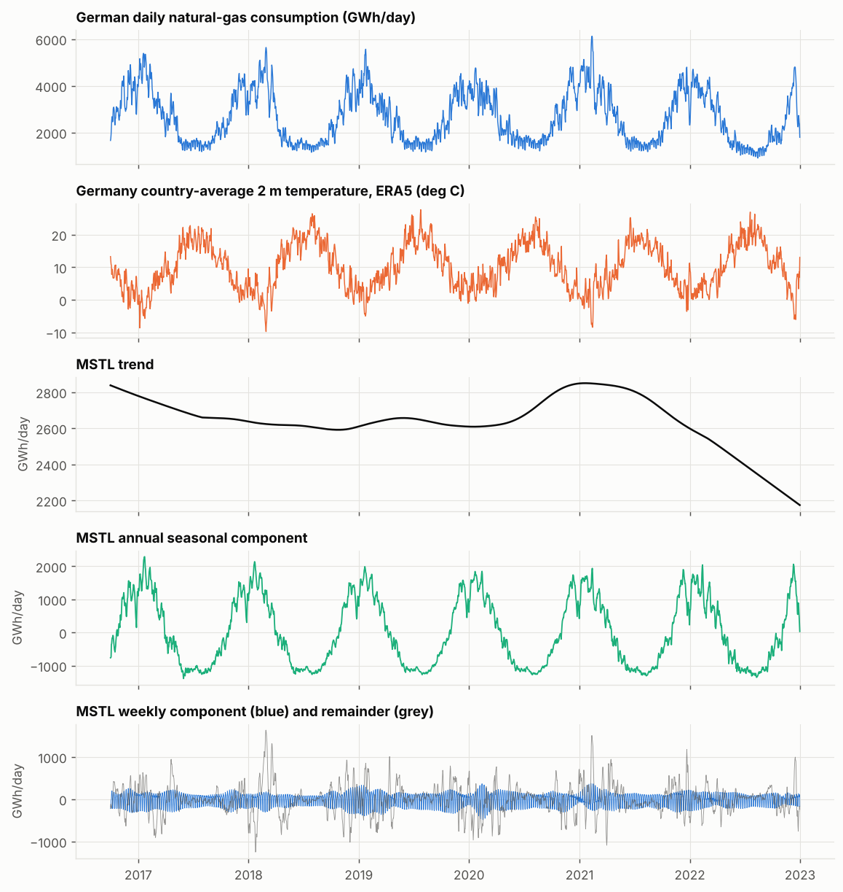
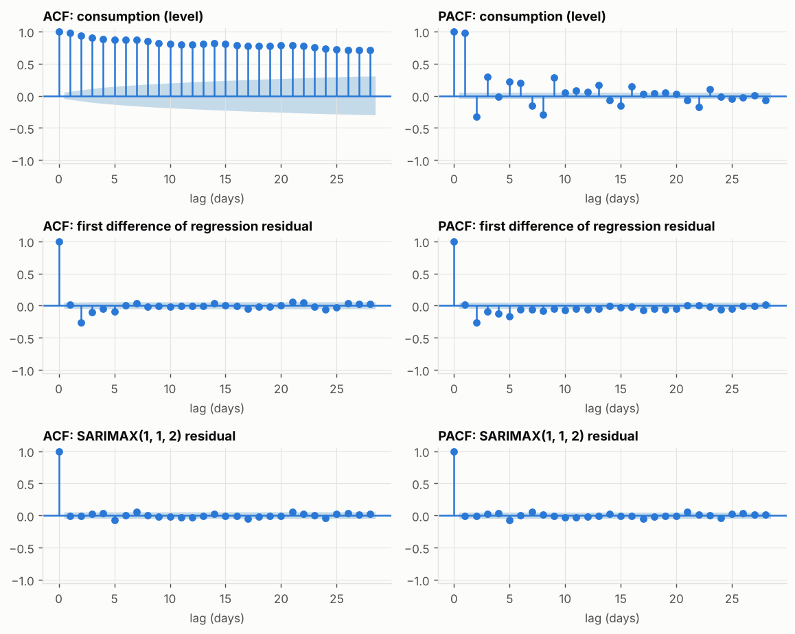
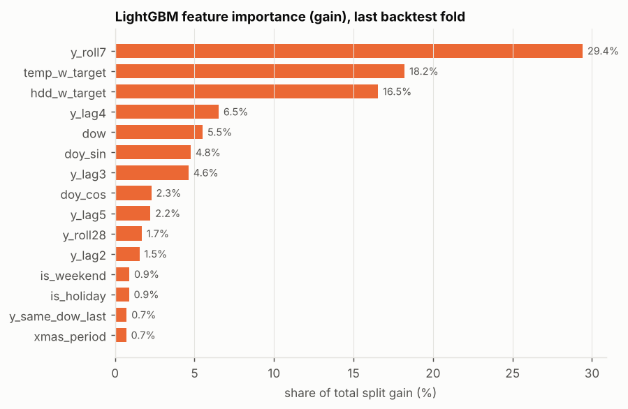

# Energy demand forecasting: German daily natural-gas consumption

Forecasting daily German natural-gas demand 1-14 days ahead with statistical baselines, a
regression model with ARIMA errors (SARIMAX) and LightGBM, evaluated with a rolling-origin
backtest, Diebold-Mariano tests, interval coverage and a stylised imbalance-cost translation.

## Business problem

A gas shipper or trader has to nominate tomorrow's volumes and hedge the coming weeks before
demand is known. Any gap between forecast and realised consumption ends up as a balancing
position. In the German market area (Trading Hub Europe, THE) that position is cashed out at
balancing prices that are less favourable than the VHP day-ahead index. Forecast accuracy over
1-14 days therefore has a direct cost. This project asks three questions:

1. How much better than naive benchmarks can daily national gas demand be forecast, 1-14 days ahead?
2. Is a gradient-boosting model better than a well-specified time-series regression on this problem?
3. Are the prediction intervals reliable, and what does the error mean in EUR under stated assumptions?

## Data

| Series | Period used | Source | Licence / terms |
|---|---|---|---|
| Daily gas consumption, all customer groups (SLP + RLM, H- and L-gas) | 2016-10-01 to 2022-12-31 | Market area managers NetConnect Germany and GASPOOL (until 2021-09-30), then Trading Hub Europe GmbH ("Aggregated consumption data") | Public transparency publications of THE; no open licence is stated, so the raw files are **not** redistributed here |
| Daily 2 m air temperature, Germany country average (NUTS0) | same | Copernicus Climate Change Service (C3S), *Climate and energy indicators for Europe from 1979 to present derived from reanalysis*, ERA5, doi:10.24381/cds.4bd77450 | Copernicus licence, attribution required: "Generated using Copernicus Climate Change Service information" |
| Daily balancing (imbalance) prices and VHP index | 2021-10-01 to 2022-11-28 | Trading Hub Europe GmbH, imbalance prices | as above |

The files are downloaded by `data/download_data.py` from a public GitHub repository that archived
them for a research project ([f-linus/natural_gas_consumption_modelling](https://github.com/f-linus/natural_gas_consumption_modelling),
pinned to commit `be4c9ed`). Only derived results are committed.

Construction (`src/data.py`): before October 2021 Germany had two market areas, so national
demand is NCG + GASPOOL (unit-harmonised to GWh/day); from 2021-10-01 the merged THE area is used.
The sample is 2,283 days without gaps, mean demand 2,663 GWh/day (about 970 TWh/year).
The sample ends on 2022-12-31 because the temperature extract ends there.

Two features of the data shape every modelling choice:

* Demand is driven by heating. Below about 15 deg C consumption rises almost linearly as
  temperature falls ([scatter](reports/figures/fig2_demand_vs_temperature.png)). Weekends are
  about 300 GWh/day lower and public holidays about 200 GWh/day lower (SARIMAX coefficients), mainly
  because industry consumes less.
* There is a **structural break** in autumn 2022: after the price shock, demand at a given
  temperature fell visibly (orange points in the scatter, MSTL trend below). Half of the test
  period lies in 2022, so the backtest is not a calm-market evaluation.



## Approach

**Models** (all in `src/models.py`, one interface `fold -> mean, lo, hi`):

| Model | What it uses | Why it is here |
|---|---|---|
| Seasonal naive (m = 7) | same weekday last week | minimal benchmark and MASE scale |
| ETS(A,Ad,A), weekly seasonality (Holt-Winters) | consumption only, last 2 years | univariate benchmark: how far can you go without weather? |
| Regression with ARIMA(1,1,2) errors ("SARIMAX") | weighted heating degree days, holiday and Christmas flags, weekday dummies | classical, interpretable model for temperature-driven load |
| LightGBM, direct multi-horizon | consumption lags, rolling means, temperature forecast, calendar | non-linear benchmark that is popular in practice |

**SARIMAX specification** (`src/diagnostics.py`, data up to the first origin only):

* Exogenous part: heating degree days `max(15 - T_w, 0)`, where `T_w` is the geometrically
  weighted temperature of the day and the three previous days (weights 1, 0.5, 0.25, 0.125, as
  in the German standard load profile methodology), to capture the thermal inertia of buildings.
* Weekly seasonality is modelled with weekday dummies, not seasonal differencing: a seasonal
  MA term on a seasonally differenced model went to -1 in exploration, which signals
  deterministic, not stochastic, weekly seasonality.
* Differencing: on the regression residual, ADF rejects a unit root (p < 0.001) but KPSS rejects
  stationarity (p <= 0.01), and the residual ACF decays slowly (lag 14 about 0.3). After one
  difference both tests agree (ADF p < 0.001, KPSS p >= 0.10), so d = 1. This also lets the level
  adapt to shifts such as the 2022 demand drop.
* ACF/PACF of the differenced residual show a clear spike at lag 2 and a short tail, which suggests
  low-order MA terms. A 3 x 3 grid over p, q in {0, 1, 2} ranked by BIC selects **ARIMA(1,1,2)**
  (BIC 18,119; second best (2,1,2) at 18,126).
* Residual diagnostics: Ljung-Box p-values are 0.003 (lag 7), 0.037 (lag 14), 0.047 (lag 28).
  Some autocorrelation remains (the largest residual autocorrelation is about -0.07 at lag 5), the
  residuals are heavy-tailed (Jarque-Bera p < 0.01) and heteroskedastic (larger in winter). I kept
  the BIC choice because larger orders did not remove it either (table
  `reports/tables/arima_order_selection.md`) and point forecasts are the main goal.



**No look-ahead** (`src/features.py`, tested in `tests/test_features.py`, `tests/test_day_ahead.py`):

* *Future weather is not known.* Realised temperature after the origin is never used. A
  temperature-forecast archive is simulated as `realised + N(0, sd_h)`, with
  `sd_h = 0.8 + 0.2 (h - 1)` deg C. This is an **assumption** (no real archive of weather
  forecasts was available), applied identically to SARIMAX and LightGBM. A sensitivity run with
  perfect temperature is reported separately.
* LightGBM uses a *direct* strategy: a row is (origin t, horizon h). All consumption features
  are dated <= t (lags 0-13, 7- and 28-day means, last observed value on the target weekday), and
  calendar and temperature-forecast features describe day t+h. Training rows are kept only if their
  target date is <= the fold origin. Tests check that corrupting all data after the origin leaves
  the features unchanged.
* LightGBM predicts `y(t+h) - mean(y(t-6..t))`, and two quantile models (5% and 95%) give the
  interval. The feature set (absolute lag levels vs. lags relative to the weekly mean) was chosen on
  **validation folds in 2019-2020** (`src/validate_lgbm.py`), never on the test folds. Absolute levels won
  (validation MAE 168 vs 180 GWh/day).

**Evaluation** (`src/backtest.py`, `src/metrics.py`):

* Rolling origin with an expanding window: 34 origins every 21 days from 2021-01-03 to 2022-11-27,
  horizons 1-14 days, so 476 forecasts per model. Every model is re-estimated at every origin.
* Metrics: MAE, RMSE, MAPE and MASE (scaled by the in-sample MAE of the weekly seasonal naive at each origin).
* Diebold-Mariano test (Harvey-Leybourne-Newbold correction) between the two best models, for
  each horizon and pooled per origin. Origins are 21 days apart, so 14-day windows do not overlap.
* Empirical coverage of the nominal 90% prediction intervals.
* An additional **day-ahead** evaluation: each fold's fitted model is rolled forward one day at a time
  until the next origin, using newly observed consumption but no re-estimation. This gives one
  h = 1 forecast for each of the 727 test days, which is what a daily nomination needs.

## Results

### 1-14 day backtest (34 origins, 2021-2022)

| Model | MAE (GWh/d) | RMSE | MAPE % | MASE | 90% PI coverage | mean PI width |
|---|---:|---:|---:|---:|---:|---:|
| **SARIMAX (1,1,2) + HDD** | **161** | **214** | **6.8** | **0.40** | 75.6% | 460 |
| LightGBM | 207 | 284 | 8.6 | 0.52 | 71.2% | 577 |
| ETS (Holt-Winters) | 394 | 610 | 15.6 | 0.98 | 92.9% | 2,078 |
| Seasonal naive | 483 | 669 | 18.3 | 1.20 | 91.0% | 2,258 |

MAPE by horizon (%):

| h | SARIMAX | LightGBM | ETS | Seasonal naive |
|---:|---:|---:|---:|---:|
| 1 | 4.2 | 6.1 | 5.9 | 11.0 |
| 3 | 3.9 | 5.7 | 11.5 | 15.9 |
| 7 | 7.4 | 9.4 | 17.2 | 16.5 |
| 14 | 8.6 | 10.8 | 18.7 | 20.8 |


**Diebold-Mariano, SARIMAX vs LightGBM** (negative = SARIMAX has the lower loss, n = 34 per row):

| Horizon | squared loss: DM (p) | absolute loss: DM (p) |
|---|---|---|
| 1 | -2.31 (0.028) | -2.29 (0.029) |
| 3 | -1.80 (0.081) | -2.28 (0.029) |
| 7 | -1.36 (0.18) | -1.32 (0.20) |
| 14 | -1.27 (0.21) | -1.31 (0.20) |
| 1-14 pooled per origin | -1.69 (0.10) | -2.01 (0.053) |

With 34 origins, SARIMAX is significantly better at short horizons. At 7-14 days the difference is
not significant at 5%: the error there is dominated by the (simulated) temperature forecast, which
both models share.

### Day-ahead, every day of 2021-2022 (727 forecasts)

| Model | MAE (GWh/d) | MAPE % | bias (actual - forecast) | 90% PI coverage |
|---|---:|---:|---:|---:|
| SARIMAX | 76.6 | 3.25 | -8.8 | 83.5% |
| LightGBM | 164.4 | 6.39 | -51.3 | n/a |
| Seasonal naive | 399.0 | 14.45 | -16.4 | n/a |

Diebold-Mariano on the daily series (Newey-West variance, 7 lags): DM = -5.16 (squared loss) and
-6.70 (absolute loss), p < 0.001. Most of LightGBM's gap comes from **September to December 2022**,
where it over-forecast by 341 GWh/day on average (MAPE 14.4% vs 4.0% for SARIMAX). In 2021 its
day-ahead MAPE was 5.2%. Trees map a given temperature and lag level to demand levels seen in the
past and cannot extrapolate a new demand regime. The integrated ARIMA error lets SARIMAX re-level
within days.

### Prediction intervals

The ETS and naive intervals reach nominal coverage, but only because they are very wide.
The SARIMAX and LightGBM intervals are **too narrow** (76% and 71% vs 90% nominal):
the SARIMAX interval ignores the uncertainty of the temperature forecast and of the parameters, and
the LightGBM quantile models are fitted in-sample and inherit the 2022 bias. Fan chart for the last
origin (cold spell of December 2022):


### Value of a better weather forecast (SARIMAX sensitivity)

Using the same fitted models with perfect future temperature instead of the simulated forecast
lowers the 1-14 day MAE from 161 to 124 GWh/day (MAPE 6.8% to 5.4%). At h = 1 the gain is small
(94 to 87), at h = 14 large (208 to 134). Beyond a few days, the quality of the temperature forecast
matters more than the choice of model.

### LightGBM feature importance



The trailing 7-day mean (level) and the forecast weighted temperature / HDD of the target day carry
about two thirds of the split gain. Recent lags and calendar terms come next.

## What forecast error means for a gas shipper (illustrative)

Stylised assumptions (`src/business.py`): a shipper supplies **1% of German demand**, its
portfolio inherits the model's day-ahead errors, it buys the forecast volume at the VHP index,
and any shortfall (surplus) is settled at THE's positive (negative) balancing price. The cost of an error
is measured against the index: `short x (pos - index)` or `long x (index - neg)`. Over the 424
days with published prices (2021-10-01 to 2022-11-28), the spreads averaged 5.6 EUR/MWh (pos -
index) and 7.8 EUR/MWh (index - neg), with peaks of 47 and 70 EUR/MWh during the 2022 crisis.

| Day-ahead model | mean abs. error (MWh/day) | mean imbalance cost (EUR/day) | total over 424 days (EUR) |
|---|---:|---:|---:|
| SARIMAX | 804 | 4,936 | 2.09 m |
| LightGBM | 1,475 | 14,374 | 6.09 m |
| Seasonal naive | 3,477 | 24,773 | 10.50 m |

These numbers are only as good as their assumptions. Real shippers have noisier portfolios than
the national aggregate, standard-load-profile customers are allocated by formula and not metered
daily, and within-day obligations and tolerances are ignored. The calculation is meant to rank
models in money terms and to show that cost depends on the *sign* of the error (in this period a
shortfall cost less per MWh than a surplus) and on market stress. It is not a P&L estimate.

## Key takeaways, limitations, next steps

* A transparent regression with ARIMA errors on weighted heating degree days beats LightGBM
  here. The gap is significant day-ahead and at short horizons, not at 7-14 days. The main
  reason is robustness to the 2022 level shift, not raw flexibility.
* Weather is the main driver: the univariate models (ETS, naive) have 2-4x the SARIMAX error beyond two days,
  and perfect temperature would cut SARIMAX error by about a quarter.
* **Limitations.** The temperature forecast is simulated with an assumed error, so real-world error
  at 7-14 days could differ. The national aggregate is smoother than any single portfolio. The
  intervals are under-covered. SARIMAX residuals keep mild autocorrelation (Ljung-Box p of 0.003-0.047).
  Validation folds for LightGBM contained no regime change, so they could not reveal its weakness under
  a break. There is a single test period, and it includes a crisis.
* **Next steps.** Calibrate the intervals on past backtest errors (conformal or empirical quantiles
  per horizon) and add temperature-forecast variance to the SARIMAX interval. Use an archive of real
  weather forecasts. Model SLP and RLM separately (the RLM/industrial segment drove the 2022 drop).
  Give LightGBM a level-robust target (for example the residual of the SARIMAX model) and add
  price features (gas price as a demand-destruction driver). Run hourly models for within-day balancing.

## How to run

```bash
pip install -r requirements.txt
make all          # download data, validate LightGBM features, run pipeline, run tests
# or step by step
python data/download_data.py
python -m src.validate_lgbm   # ~1.5 min, writes reports/tables/lgbm_feature_set_validation.md
python -m src.pipeline        # ~3.5-7 min on 2 CPUs, writes reports/figures and reports/tables
python -m pytest -q
```

Random seed 42 is used everywhere (temperature-forecast simulation, LightGBM). Measured runtime of
`python -m src.pipeline` in the development sandbox (2 shared CPUs): 3 min 30 s to 6 min 40 s,
depending on machine load.

## Project structure

```
data/download_data.py      fetches raw files (pinned commit) into data/raw/ (git-ignored)
src/config.py              paths, sample period, backtest design, temperature-forecast assumption
src/data.py                loading and harmonising NCG + GASPOOL + THE, ERA5 temperature, prices
src/calendar_de.py         German national holidays (Easter algorithm), calendar features
src/features.py            simulated temperature-forecast archive, leakage-safe direct features
src/models.py              seasonal naive, ETS, SARIMAX, LightGBM (point + intervals)
src/diagnostics.py         MSTL, ADF/KPSS, ARIMA order grid (BIC), Ljung-Box
src/backtest.py            rolling-origin splitter and backtest runner
src/day_ahead.py           daily h=1 roll-forward of fitted models
src/metrics.py             MAE, RMSE, MAPE, MASE, coverage, interval score, Diebold-Mariano
src/business.py            stylised imbalance-cost translation
src/validate_lgbm.py       feature-set choice on 2019-2020 validation folds
src/pipeline.py            entry point: python -m src.pipeline
src/plots.py               figures
tests/                     pytest: no-leakage features, day-ahead roll-forward, metrics, splitter, calendar
reports/figures, reports/tables   generated outputs (committed)
```

## License

Code: MIT (see `LICENSE`). Data remain under the terms of their providers (see Data).
